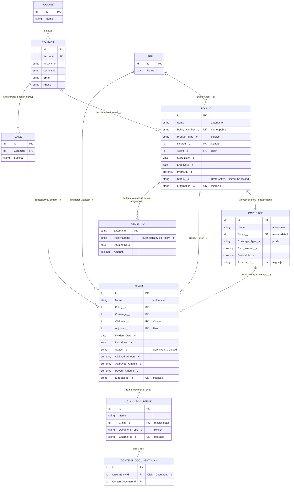

# Model danych (ERD)

- **Status:** projekt (M2, #29) — implementacja metadanych: #30 (`Policy__c`, `Coverage__c`) i #31 (`Claim__c`, `Claim_Document__c`)
- **Wymagania:** FR-POL-01, FR-CLM-01, NFR-CMP-03 (powiązane: FR-POL-02, FR-CLM-03, FR-CLM-06, NFR-SEC-01, NFR-CMP-01)
- **Decyzje:** [ADR-0002](../adr/0002-custom-objects-vs-fsc.md) (obiekty custom zamiast FSC)

Dokument opisuje docelowy model danych. Jest specyfikacją dla zadań #30 i #31; po ich wdrożeniu metadane w `force-app/` są źródłem prawdy, a ewentualne różnice należy tu odnotować.

## 1. Diagram ERD

Legenda: `PK` — klucz główny, `FK` — klucz obcy (lookup lub master-detail), `UK` — pole unikalne (External ID). `Account`, `Contact`, `User`, `Case`, `ContentDocumentLink` są obiektami standardowymi; `Policy__c`, `Coverage__c`, `Claim__c`, `Claim_Document__c` — custom. `PAYMENT_X` to obiekt zewnętrzny (OData, M5), którego **dane nie są kopiowane do CRM** (NFR-CMP-01). Statusy: polisa Draft → Active → Expired/Cancelled (FR-POL-03); szkoda Submitted → Under Review → Approved/Rejected → Paid → Closed (FR-CLM-02).

## 2. Relacje i uzasadnienie

| Relacja                          | Typ                   | Uzasadnienie                                                                                                                                                                               |
| -------------------------------- | --------------------- | ------------------------------------------------------------------------------------------------------------------------------------------------------------------------------------------ |
| `Policy__c` → `Contact`          | Lookup (wymagany)     | Ubezpieczony to `Contact` powiązany z `Account` (ADR-0002); użytkownik portalu jest powiązany z kontaktem, co umożliwia Sharing Sets (NFR-SEC-07).                                         |
| `Policy__c` → `User` (agent)     | Lookup (wymagany)     | Podstawa reguł współdzielenia „portfel agenta” (FR-POL-04).                                                                                                                                |
| `Coverage__c` → `Policy__c`      | Master-detail         | Zakres nie istnieje bez polisy; przy OWD Private rekord potomny dziedziczy widoczność po polisie, więc nie trzeba utrzymywać osobnego współdzielenia.                                      |
| `Claim__c` → `Policy__c`         | Lookup (wymagany)     | Szkoda ma własny cykl życia i własny model dostępu (likwidator, agent, klient), dlatego nie dziedziczy sharingu po polisie; usuwanie polisy ze szkodami blokowane (`restrict delete`).     |
| `Claim__c` → `Coverage__c`       | Lookup (wymagany)     | FR-CLM-01: szkoda wskazuje zakres obowiązujący w dniu zdarzenia. Spójność (zakres należy do tej samej polisy, polisa aktywna w `Incident_Date__c`) wymusza logika Apex (#35), nie schemat. |
| `Claim_Document__c` → `Claim__c` | Master-detail         | Dokument dziedziczy widoczność po szkodzie; usunięcie szkody usuwa metadane dokumentów.                                                                                                    |
| Pliki → `Claim_Document__c`      | `ContentDocumentLink` | Pliki (Salesforce Files) podpinane do rekordu `Claim_Document__c`; limity rozmiaru i typów MIME: NFR-SEC-10 (#49).                                                                         |
| `Case` → `Contact`               | Standardowa           | Komunikacja klient–agent (FR-COM, M3); `Case` nie reprezentuje szkody (ADR-0002, opcja 3).                                                                                                 |
| Płatności (External Object)      | Brak kopii            | Powiązanie logiczne po numerze polisy (M5); dane płatnicze zostają w systemie źródłowym.                                                                                                   |

### Założenia dla implementacji (#30, #31)

- OWD **Private** dla `Policy__c` i `Claim__c` (NFR-SEC-01); `Coverage__c` i `Claim_Document__c` dziedziczą dostęp po rodzicu (master-detail). OWD dla `Contact`/`Account` ustala zadanie dot. sharingu (#32).
- Każdy z czterech obiektów ma pole `External_Id__c` (Text, unique, External ID) pod migrację z backendu Python (M4) i upsert po kluczu zewnętrznym.
- Statusy jako picklisty z regułami walidacji ścieżek przejść (FR-POL-03, FR-CLM-02); Field History Tracking dla `Claim__c.Status__c` oraz kwot (FR-CLM-06, #31).
- Nazwy API są propozycją; ostateczne ustalają #30/#31 — zmiany należy odzwierciedlić w tym dokumencie.

## 3. Lista pól i klasyfikacja danych

Klasyfikacja:

- **PII** — dane osobowe w rozumieniu RODO (identyfikują osobę lub umożliwiają kontakt);
- **Wrażliwe** — dane o podwyższonym ryzyku: kwoty finansowe, swobodne opisy mogące zawierać dane zdrowotne lub osobowe, dokumenty;
- **Biznesowe** — dane operacyjne bez bezpośredniej identyfikacji osoby;
- **Techniczne** — identyfikatory i pola systemowe.

Kolumna „FLS” to rekomendacja dostępu dla zestawów uprawnień: A — Agent, L — Likwidator, K — Klient portalu; R — odczyt, E — edycja, `-` — brak. Ostateczna macierz powstanie w #33 (NFR-SEC-02).

### 3.1 `Policy__c`

| Pole API           | Typ                     | Klasyfikacja  | Uzasadnienie / minimalizacja (NFR-CMP-03)                                      | FLS (A/L/K) |
| ------------------ | ----------------------- | ------------- | ------------------------------------------------------------------------------ | ----------- |
| `Name`             | Auto Number             | Techniczne    | Identyfikator rekordu                                                          | E/R/R       |
| `Policy_Number__c` | Text(30), unique        | Biznesowe     | Numer polisy; pośrednio identyfikuje osobę — nie logować w komunikatach błędów | E/R/R       |
| `Product_Type__c`  | Picklist                | Biznesowe     | Wymagane do procesu                                                            | E/R/R       |
| `Insured__c`       | Lookup(Contact)         | PII (relacja) | Wiąże polisę z osobą; dane osoby zostają w `Contact`, nie są powielane         | E/R/R       |
| `Agent__c`         | Lookup(User)            | Biznesowe     | Podstawa portfela agenta i sharingu                                            | R/R/R       |
| `Start_Date__c`    | Date                    | Biznesowe     | Okres ochrony; reguły walidacji dat                                            | E/R/R       |
| `End_Date__c`      | Date                    | Biznesowe     | Podstawa wygaszania polis (FR-POL-05)                                          | E/R/R       |
| `Premium__c`       | Currency                | Wrażliwe      | Składka (dane finansowe); ukryta przed rolami bez potrzeby biznesowej          | E/R/R       |
| `Status__c`        | Picklist                | Biznesowe     | Draft / Active / Expired / Cancelled                                           | E/R/R       |
| `External_Id__c`   | Text(50), unique, ExtId | Techniczne    | Klucz migracji; w dev/CI wyłącznie identyfikatory syntetyczne (NFR-CMP-02)     | R/-/-       |

### 3.2 `Coverage__c`

| Pole API           | Typ                     | Klasyfikacja | Uzasadnienie / minimalizacja                | FLS (A/L/K) |
| ------------------ | ----------------------- | ------------ | ------------------------------------------- | ----------- |
| `Name`             | Auto Number             | Techniczne   | Identyfikator                               | E/R/R       |
| `Policy__c`        | Master-Detail(Policy)   | Biznesowe    | Rodzic; dziedziczenie widoczności           | E/R/R       |
| `Coverage_Type__c` | Picklist                | Biznesowe    | Rodzaj ochrony                              | E/R/R       |
| `Sum_Insured__c`   | Currency                | Wrażliwe     | Limit odpowiedzialności; podstawa FR-CLM-05 | E/R/R       |
| `Deductible__c`    | Currency                | Wrażliwe     | Udział własny; podstawa FR-CLM-05           | E/R/R       |
| `External_Id__c`   | Text(50), unique, ExtId | Techniczne   | Klucz migracji                              | R/-/-       |

### 3.3 `Claim__c`

| Pole API             | Typ                     | Klasyfikacja  | Uzasadnienie / minimalizacja                                                                               | FLS (A/L/K)        |
| -------------------- | ----------------------- | ------------- | ---------------------------------------------------------------------------------------------------------- | ------------------ |
| `Name`               | Auto Number             | Techniczne    | Identyfikator                                                                                              | R/R/R              |
| `Policy__c`          | Lookup(Policy)          | Biznesowe     | Polisa, której dotyczy szkoda                                                                              | R/R/R              |
| `Coverage__c`        | Lookup(Coverage)        | Biznesowe     | Zakres obowiązujący w dniu zdarzenia (FR-CLM-01)                                                           | R/E/R              |
| `Claimant__c`        | Lookup(Contact)         | PII (relacja) | Zgłaszający; bez kopiowania danych kontaktowych do szkody                                                  | R/R/R              |
| `Adjuster__c`        | Lookup(User)            | Biznesowe     | Likwidator (FR-CLM-04); właścicielem rekordu może być kolejka                                              | R/E/-              |
| `Incident_Date__c`   | Date                    | Biznesowe     | Data zdarzenia                                                                                             | R/R/E (zgłoszenie) |
| `Description__c`     | Long Text(5000)         | Wrażliwe      | Opis zdarzenia od klienta; może zawierać dane osobowe/zdrowotne — w formularzu ostrzeżenie o minimalizacji | R/R/E              |
| `Status__c`          | Picklist                | Biznesowe     | Cykl życia (FR-CLM-02); Field History Tracking (FR-CLM-06)                                                 | R/E/R              |
| `Claimed_Amount__c`  | Currency                | Wrażliwe      | Kwota zgłoszona; Field History                                                                             | R/R/E (zgłoszenie) |
| `Approved_Amount__c` | Currency                | Wrażliwe      | Kwota zatwierdzona przez likwidatora; Field History                                                        | -/E/R              |
| `Payout_Amount__c`   | Currency                | Wrażliwe      | Kwota wypłaty, limit z FR-CLM-05; Field History. Transakcje płatnicze pozostają poza CRM                   | -/E/R              |
| `External_Id__c`     | Text(50), unique, ExtId | Techniczne    | Klucz migracji                                                                                             | R/-/-              |

### 3.4 `Claim_Document__c`

| Pole API                   | Typ                     | Klasyfikacja | Uzasadnienie / minimalizacja                                                                                               | FLS (A/L/K) |
| -------------------------- | ----------------------- | ------------ | -------------------------------------------------------------------------------------------------------------------------- | ----------- |
| `Name`                     | Text(80)                | Techniczne   | Etykieta dokumentu; nie wpisywać danych osobowych w nazwie                                                                 | R/E/E       |
| `Claim__c`                 | Master-Detail(Claim)    | Biznesowe    | Rodzic; dziedziczenie widoczności                                                                                          | R/R/R       |
| `Document_Type__c`         | Picklist                | Biznesowe    | Rodzaj (zdjęcie, protokół, faktura)                                                                                        | R/E/E       |
| `External_Id__c`           | Text(50), unique, ExtId | Techniczne   | Klucz migracji                                                                                                             | R/-/-       |
| (pliki — `ContentVersion`) | Salesforce Files        | Wrażliwe     | Treść może zawierać PII i dane zdrowotne; limit rozmiaru i typów MIME (NFR-SEC-10), widoczność przez `ContentDocumentLink` | R/R/E       |

### 3.5 Standardowe obiekty użyte w modelu

Dane osobowe znajdują się wyłącznie w obiektach standardowych; obiekty custom odwołują się do nich relacjami, bez duplikowania.

| Obiekt.pole                      | Klasyfikacja     | Uwagi                                                                                        |
| -------------------------------- | ---------------- | -------------------------------------------------------------------------------------------- |
| `Contact.FirstName/LastName`     | PII              | Wymagane do identyfikacji ubezpieczonego                                                     |
| `Contact.Email`, `Contact.Phone` | PII              | Wymagane do kontaktu i logowania do portalu; w danych testowych wyłącznie adresy syntetyczne |
| `Contact.MailingAddress`         | PII              | Opcjonalne; pominąć, jeśli proces tego nie wymaga (minimalizacja)                            |
| `Account.Name`                   | PII / biznesowe  | W modelu B2C może zawierać nazwisko                                                          |
| `User` (agent, likwidator)       | PII (pracownicy) | Widoczność użytkowników ograniczona do niezbędnej                                            |
| `Case.Subject`, treść            | Wrażliwe         | Swobodny tekst klienta (M3); polityka jak dla `Claim__c.Description__c`                      |

Pola, których celowo **nie** przechowujemy (NFR-CMP-03): PESEL i numer dokumentu tożsamości, data urodzenia, numery kont bankowych i kart, dane zdrowotne w polach ustrukturyzowanych. Dane płatnicze zostają w systemie zewnętrznym (NFR-CMP-01).

## 4. Dane syntetyczne

Wszystkie rekordy w środowiskach deweloperskich i CI są syntetyczne (NFR-CMP-02): losowe imiona, adresy e-mail w domenie zarezerwowanej `example.com`, losowe numery polis. Plany danych (`sf data import tree`) — zadanie #41.

## 5. Powiązane

- [ADR-0002](../adr/0002-custom-objects-vs-fsc.md), [WYMAGANIA.md](../WYMAGANIA.md), [HARMONOGRAM.md](../HARMONOGRAM.md)
- Zadania wdrożeniowe: #30, #31; sharing i uprawnienia: #32, #33.
