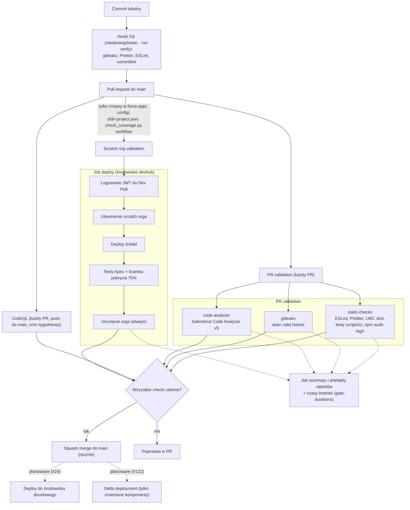

# Potok CI/CD

Stan na 2026-11-06. Potok służy jednemu celowi: każda zmiana w PR do `main` przechodzi automatyczne bramki jakości i bezpieczeństwa, zanim trafi do gałęzi głównej. Decyzja o narzędziu: [ADR 0008](../adr/0008-github-actions-vs-copado.md).

> **Stan faktyczny.** Workflowy odpalają się dla PR do `main`, ale **branch protection nie jest egzekwowane**: ruleset `main` zawiera wyłącznie regułę blokady usunięcia gałęzi (zadania #6 i #25, po stronie właściciela repozytorium). Bramki poniżej oblewają check PR-a, lecz GitHub nie blokuje merge'a przy czerwonym checku, dopóki nie zostaną ustawione wymagane checki. Elementy oznaczone „planowane” nie istnieją jeszcze w repozytorium (deploy #24, delta deployment #122, wymagane checki #25).

## Diagram jobów i bramek

## Joby i bramki

| Workflow / job                      | Wyzwalacz                                            | Co sprawdza                                                                                                                                        | Warunek oblania                                                                              | Wymaganie            |
| ----------------------------------- | ---------------------------------------------------- | -------------------------------------------------------------------------------------------------------------------------------------------------- | -------------------------------------------------------------------------------------------- | -------------------- |
| `pr-validation` / `static-checks`   | każdy PR do `main`                                   | ESLint (LWC/Aura), Prettier, testy LWC Jest, testy `scripts/ci`, `npm audit --audit-level=high`                                                    | błąd dowolnego kroku; podatność high/critical w zależnościach                                | FR-CI-01, FR-CI-05   |
| `pr-validation` / `gitleaks`        | każdy PR do `main`                                   | skan sekretów w całej historii (SARIF do code scanning, `--redact`)                                                                                | wykryty sekret                                                                               | FR-CI-05             |
| `pr-validation` / `code-analyzer`   | każdy PR do `main`                                   | Salesforce Code Analyzer v5 (reguły wg [ADR 0004](../adr/0004-code-analyzer-rules.md)), SARIF do code scanning                                     | naruszenie Critical lub High                                                                 | FR-CI-04             |
| `codeql` / `analyze`                | PR do `main`, push do `main`, cron `17 4 * * 1`      | CodeQL `security-extended` dla JS/TS ([ADR 0005](../adr/0005-codeql-workflow.md))                                                                  | sam workflow nie oblewa PR; alerty trafiają do Security, blokada wymaga reguły code scanning | FR-CI-06             |
| `scratch-org-validation` / `deploy` | PR do `main` zmieniający ścieżki metadanych          | efemeryczny scratch org (1 dzień), deploy źródeł, testy Apex z pokryciem, `check_coverage.py` (próg 75%), usunięcie orga w `always()`              | błąd deployu, nieudane testy, pokrycie poniżej progu                                         | FR-CI-02, FR-CI-03   |
| Dependabot (`dependabot.yml`)       | cotygodniowo                                         | PR-y aktualizujące zależności npm i akcje GitHub ([ADR 0006](../adr/0006-dependabot-npm-audit.md))                                                 | nie dotyczy (źródło PR-ów)                                                                   | FR-CI-05             |
| Hooki Git (Husky)                   | lokalnie, `pre-commit` i `commit-msg`                | gitleaks na staged, Prettier, ESLint, commitlint ([ADR 0007](../adr/0007-hooki-husky-commitlint.md))                                               | obchodliwe przez `--no-verify`, więc nie są bramką                                           | FR-CI-09             |
| Raporty i czasy bramek              | w każdym jobie powyżej (ostatni krok `if: always()`) | podsumowanie w zakładce przebiegu, artefakty z surowymi raportami, czasy kroków ([ADR 0010](../adr/0010-raporty-bramek-w-podsumowaniu-zadania.md)) | nie dotyczy (błąd raportowania to ostrzeżenie, nie oblanie bramki)                           | FR-CI-07, NFR-OBS-02 |
| Deploy                              | planowane (#24)                                      | wdrożenie po merge'u do `main`                                                                                                                     | do uzupełnienia                                                                              | FR-CI-08             |
| Delta deployment                    | planowane (#122)                                     | wdrażanie tylko zmienionych komponentów                                                                                                            | do uzupełnienia                                                                              | do uzupełnienia      |
| Wymagane checki (branch protection) | planowane (#25, #6)                                  | blokada merge'a przy czerwonych checkach                                                                                                           | do uzupełnienia                                                                              | do uzupełnienia      |

> Pozostałe pozycje „planowane” (#24, #122, #25) trzeba przenieść do tabeli faktycznej po ich merge'u i zmienić diagram.

## Raporty, artefakty i czasy bramek

Zrealizowane w #22 (PR [#119](https://github.com/Yibux/insurance-app/pull/119) i [#121](https://github.com/Yibux/insurance-app/pull/121)), decyzja: [ADR 0010](../adr/0010-raporty-bramek-w-podsumowaniu-zadania.md). Szczegóły i dowody: wpisy „#22” oraz „Poprawki z przeglądu bezpieczeństwa PR #119” w [logu etapu M1](../implementacja/M1-potok-devsecops.md).

**Podsumowanie przebiegu (job summary).** Skrypt `scripts/ci/gate_report.py` (biblioteka standardowa, testy w `test_gate_report.py`) ma trzy podkomendy i dopisuje Markdown do `$GITHUB_STEP_SUMMARY`. Brak lub uszkodzenie pliku wejściowego nie ukrywa pierwotnego błędu (ostrzeżenie, raport pominięty).

| Podkomenda      | Job                                  | Zawartość podsumowania                                                       |
| --------------- | ------------------------------------ | ---------------------------------------------------------------------------- |
| `apex-tests`    | `scratch-org-validation` / `deploy`  | wyniki testów Apex; tabela pokrycia per klasa pochodzi z `check_coverage.py` |
| `code-analyzer` | `pr-validation` / `code-analyzer`    | liczby naruszeń wg wagi (Critical..Info) względem progu `SEVERITY_THRESHOLD` |
| `durations`     | wszystkie joby (przez akcję poniżej) | czas każdego kroku joba                                                      |

**Czasy bramek.** Lokalna akcja kompozytowa `.github/actions/gate-durations` jest ostatnim krokiem (`if: always()`) jobów `static-checks`, `gitleaks`, `code-analyzer` i `deploy`. Pobiera czasy kroków z API Actions (`/actions/runs/{id}/attempts/{n}/jobs`, uprawnienie `actions: read`), dopisuje tabelę do podsumowania i wysyła surowe wiersze jako artefakt `gate-durations-*`. Pomiar jest best effort: błąd API lub skryptu kończy się ostrzeżeniem, a czas samego kroku raportującego i całego joba jest niedokładny (job jeszcze trwa). Dane są wejściem do eksperymentu M6.

**Artefakty.**

| Artefakt                                                                      | Workflow / job                      | Zawartość                                           | Retencja |
| ----------------------------------------------------------------------------- | ----------------------------------- | --------------------------------------------------- | -------- |
| `code-analyzer-report`                                                        | `pr-validation` / `code-analyzer`   | `code-analyzer.sarif`, `.html`, `.json`             | 14 dni   |
| `gitleaks-report`                                                             | `pr-validation` / `gitleaks`        | raport SARIF (`--redact`)                           | 3 dni    |
| `apex-test-results`                                                           | `scratch-org-validation` / `deploy` | katalog wyników `sf apex run test` (JSON, pokrycie) | 14 dni   |
| `gate-durations-static-checks`, `-gitleaks`, `-code-analyzer`, `-scratch-org` | odpowiednio każdy job               | `durations.json` z czasami kroków                   | 14 dni   |

Retencja `gitleaks-report` wynosi 3 dni, bo dotyczy wykrytych sekretów; wykrycie sekretu wymaga jego rotacji, a nie tylko usunięcia z historii lub raportu (repozytorium jest publiczne). Ograniczenie: `apex-test-results` i krok „Apex test results summary” uruchamiają się tylko, gdy w `force-app/` są klasy testowe Apex; repozytorium ich jeszcze nie ma, więc ta ścieżka nie była dotąd zweryfikowana w CI.

## Cechy wspólne

- **Uprawnienia:** `permissions: contents: read` na poziomie workflow; `security-events: write` tylko tam, gdzie wysyłany jest SARIF; `actions: read` tylko w jobach używających akcji `gate-durations`.
- **Łańcuch dostaw:** wszystkie akcje przypięte do pełnego SHA z tagiem w komentarzu, wersje narzędzi (SF CLI 2.156.8, Code Analyzer 5.16.0, gitleaks 8.30.1 z sumą SHA-256) przypięte; aktualizacje przez Dependabota. `persist-credentials: false` przy checkout.
- **Współbieżność:** `concurrency` per PR z `cancel-in-progress`; dodatkowo globalna grupa `devhub-scratch-org` ogranicza liczbę równoległych scratch orgów (limit 3 aktywnych, 6 nowych na 24 h w Dev Hubie Developer Edition).
- **Sekrety:** dane Dev Hubu (JWT) tylko w środowisku GitHub `devhub`, wykorzystywane wyłącznie przez job `deploy` ([ADR 0003](../adr/0003-jwt-bearer-ci-auth.md)); klucz usuwany z runnera po zakończeniu.
- **Separacja kosztu:** `scratch-org-validation` ma filtr `paths:`, więc PR-y dokumentacyjne nie zużywają limitu scratch orgów ([ADR 0001](../adr/0001-monorepo.md)). Pozostałe workflowy nie mają filtra, żeby mogły być wymaganymi checkami.
- **Znane ograniczenia:** PR z konfliktem scalania nie dostaje przebiegów `pull_request` w ogóle; PR niekierowany do `main` także nie uruchamia workflowów.

## Powiązanie bramek z literaturą (notatki do pracy)

| Element potoku                                                            | Źródło                         | Teza                                                                                                                                                                           |
| ------------------------------------------------------------------------- | ------------------------------ | ------------------------------------------------------------------------------------------------------------------------------------------------------------------------------ |
| Zestaw bramek na każdym PR (SAST, sekrety, SCA, testy z progiem pokrycia) | Bavadiya (2022)                | Bramki jakości w CI/CD odrzucają wadliwy kod przed środowiskiem docelowym (w badaniu ok. 93,64%); projekt bramek i eksperyment wykrywalności w M6 odtwarzają ten sposób oceny. |
| Skan sekretów, SAST i SCA przy każdym PR, a nie okresowo                  | Cheenepalli i in. (2025)       | Tylko 12% organizacji skanuje bezpieczeństwo przy każdym commicie mimo deklarowanego priorytetu (73%); potok ze skanem per PR odpowiada na tę lukę automatyzacji.              |
| Hooki lokalne jako pierwsza, nieobowiązkowa linia obrony                  | Cheenepalli i in. (2025)       | Przesunięcie kontroli w lewo skraca pętlę zwrotną, ale obejście `--no-verify` pokazuje, że obowiązkową bramką musi być CI.                                                     |
| Scratch org na PR, przypięte akcje i narzędzia                            | Bavadiya (2022), IEEE 2025 SLR | Powtarzalne, izolowane środowisko i kontrola łańcucha dostaw są warunkiem wiarygodności wyników bramek.                                                                        |

Cytaty i pełne opisy źródeł: [RAPORT.md](../RAPORT.md).
